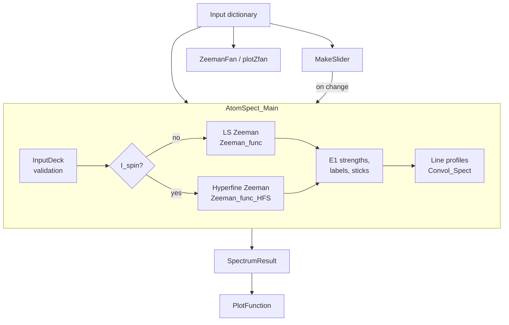

# AtomSpect

AtomSpect is a Python package for Zeeman and hyperfine spectra in plasma diagnostics. It calculates relative electric-dipole (E1) strengths from supplied atomic level energies and broadens the resulting components with Doppler and instrumental profiles.

The model treats one lower and one upper LS term in a static magnetic field, with optional nuclear spin and hyperfine constants. Calculations use NumPy, SciPy, and SymPy; plotting uses Matplotlib. The code is distributed under GPL-3.0-or-later.

See the [theory manual](doc/AtomSpect_theory_manual.pdf), [documentation guide](doc/README.md), and [review record](audit/REVIEW.md) for the equations, conventions, validation, and known limitations.

## Workflow

The flowchart follows the calculation flow in the [theory manual](doc/AtomSpect_theory_manual.pdf). An input dictionary drives `AtomSpect_Main`, the interactive `MakeSlider`, or the energy fans; `AtomSpect_Main` builds the Zeeman or hyperfine Hamiltonian, calculates E1 components, and broadens them into a spectrum.



`AtomSpect_Main` uses a scalar `Bmag` and returns data for further analysis or plotting. `MakeSlider` calls the spectrum calculation as its controls change. Energy fans sweep the Hamiltonian over a `Bmag` array; `ZeemanFan` returns energy arrays and `plotZfan` also plots them.

## Installation

Use Python 3.10 or newer. From the repository root:

```sh
python -m pip install -e .
python doc/scripts/example_minimal.py
```

To install the test dependency and run the suite:

```sh
python -m pip install -e ".[test]"
python -m pytest -q
```

Calculation imports work without a GUI. Sliders require an interactive Matplotlib backend; Tkinter is loaded only when a manual-value dialog opens, so those dialogs require a Python installation with Tk support. The documentation example runs without opening a window; add `--plot` to display its spectrum.

## Calculate a spectrum

This example uses the Ar I line near 750.4 nm. Energies are supplied in cm^-1, ordered by increasing J within each term. `s_ground` and `s_excited` are the spin quantum numbers S; a triplet has S = 1.

```python
import AtomSpect

deck = {
    "s_ground": 0, "s_excited": 0,
    "l_ground": 1, "l_excited": 0,
    "E_ground": [95399.8276],
    "E_excited": [108722.6194],
    "Bmag": 2.018,             # tesla
    "b_angle": 90,            # degrees between field and line of sight
    "amu": 40,
    "Convfxn": "GaussianInstrum",
    "Temp": 300,              # kelvin
    "specstep": 0.004,        # instrument FWHM in nm
    "specres": 10,            # nominal samples per pixel
    "spec_window": [750.0, 750.8],
    "plot_window": [750.2, 750.6],
}

result = AtomSpect.AtomSpect_Main(deck)
print(result.wave_air)         # component wavelengths in nm
print(result.signal)           # normalized relative strengths
wavelength, intensity = result.SpecOut
```

`AtomSpect_Main` returns a `SpectrumResult`. Entries support both dictionary access (`result["signal"]`) and attribute access (`result.signal`). Call `result.describe()` for descriptions of the available keys. The driver fills in a default `amu` when it is absent and retains a reference to the input dictionary.

Air wavelengths use the 1993 revised Edlén formula from [Steck, Equation (3)](https://steck.us/alkalidata/rubidium87numbers.pdf), with dry air (101325 Pa, 20 °C) as the default. For other laboratory conditions, use `Vac_to_air(wave_vac_nm, pressure_pa=101325, temperature_c=23, water_vapor_pressure_pa=1123.6)`. The water-vapor parameter is partial pressure in Pa. `air_to_vac` accepts the same parameters and numerically inverts the conversion. These options apply to the conversion helpers; spectrum calculations use the defaults.

## DC electric fields

Scalar and tensor dc Stark shifts follow [Steck, Equations (30)-(32)](https://steck.us/alkalidata/rubidium87numbers.pdf). Set `Efield` in **V/cm**, along the quantization axis (parallel to the magnetic field). Omitting `Efield` or setting it to zero preserves the current magnetic-only result without requiring polarizability data.

For a nonzero field, supply `alpha0_G` and `alpha0_E`, the **absolute scalar polarizabilities divided by Planck's constant**, in **Hz/(V/cm)²**. Optional `alpha2_G`/`alpha2_E` use the same units and default to zero. Each accepts a scalar or one value per electronic J, lowest J first; tensor entries must be zero for J < 1. The Hamiltonian contribution, expressed as a frequency, is

```text
H_dc / h = -Efield² / 2 * [alpha0 + alpha2 * (3 Jz² - J(J+1)) / (J(2J-1))]
```

The tensor contribution is zero for J < 1. Here Jz has eigenvalues mJ. The full matrix is diagonalized with the hyperfine and Zeeman terms, so the tensor interaction can mix different F states with the same mF. The retained polarizability operator is diagonal in electronic J; cross-J polarizabilities and nonparallel electric/magnetic fields are outside this model. Electric shifts must remain small enough for the supplied quadratic polarizabilities and retained electronic levels to apply. Nonzero `Efield` requires exact spectra/fans; disable `DoLowSig`/`DoHighSig` and omit fan approximation flags `L`/`H`.

For an Rb-87 deck containing lower 5S1/2 and upper 5P1/2, 5P3/2 levels:

```python
deck.update(
    Efield=1000.0,                   # V/cm
    alpha0_G=0.0794,                 # alpha0 / h, Hz/(V/cm)^2
    alpha0_E=[0.0794 + 0.122306,     # D1: add tabulated differential value
              0.0794 + 0.1340],     # D2: add tabulated differential value
    alpha2_E=[0.0, -0.0406],
)
result = AtomSpect.AtomSpect_Main(deck)
```

These polarizabilities are the central values in Steck's Table 6. They do not set the isotope, energies, or HFS constants; the rest of the deck must already describe Rb-87. The field affects wavelengths, eigenstate mixing, and transition strengths. `MakeSlider` retains these settings while changing its existing controls.

Low-level callers can pass `Efield`, `alpha0`, and `alpha2` to `Zeeman_func` or `Zeeman_func_HFS`, or obtain the coupled-basis matrix from `stark_hamiltonian(level, Efield, alpha0, alpha2)`. The calibrated atomic API provides `add_dc_stark(model, electric_field_v_cm, polarizabilities)`, where `polarizabilities` maps every level ID to `(alpha0/h, alpha2/h)`. It returns a new model and can be used before or after `add_hyperfine`. `RadiativeData` also carries the input deck's Stark shifts into the attached `AtomicComponents` result.

## Plot the result

Continue from the example above:

```python
from matplotlib import pyplot as plt

axes = AtomSpect.PlotFunction(
    result,
    ["royalblue", 1.5, "solid", "Exact"],
    NormalizeSig=True,
    show=False,
)
plt.show()
```

A plot style contains `[color, linewidth, linestyle, optional label, optional marker]`. `PlotFunction` returns a two-dimensional array of axes. To add a curve to an existing plot, pass `makefig=False`, `axsin=axes`, and `position=[row, column]`. `NormalizeSig=True` scales the displayed peak and leaves the calculated result unchanged.

`MakeSlider(deck, [measured_wavelengths, measured_intensities])` opens the interactive interface. It varies magnetic field, temperature in eV, and instrument width. `banglevary=True` adds a viewing-angle slider; `polvary=True` adds a linear-analyzer slider. The interface starts at `B=min(2.5, Bmax)` T and width 0.002 nm. Temperature comes from `TempeV` or `Temp` (default 0.05 eV), clipped to `[0.01, Tmax]`. `Bmax=5` T and `Tmax=30` eV set the slider limits. Updates change the input dictionary. Use `block=False` to return immediately and retain the figure; its `sliders` attribute holds the controls. See its docstring for the remaining options.

## Inputs and units

The eight required keys describe the terms and observation geometry:

| Keys | Meaning and unit |
|---|---|
| `s_ground`, `s_excited` | Electronic spin S, a nonnegative integer or half integer |
| `l_ground`, `l_excited` | Orbital angular momentum L |
| `E_ground`, `E_excited` | One zero-field energy per allowed J in cm^-1, lowest J first |
| `Bmag` | Scalar magnetic field in T; use an array for energy fans |
| `b_angle` | Angle between the field and line of sight in degrees |

Common optional settings are listed below. The manual's options appendix and the `AtomSpect_Main` docstring describe the full interface.

| Keys | Behavior |
|---|---|
| `amu` | Emitter mass number; default 1 |
| `Pol_angle` | Linear-analyzer angle in degrees; supplying zero also enables the analyzer |
| `TAlpha`, `TBeta` | Nonnegative intensity transmissions; both default to 1 |
| `Temp`, `TempeV` | Temperature in K or eV; `TempeV` takes precedence, using 11602 K/eV |
| `Convfxn` | `Gaussian`, `GaussianInstrum`, `Voigt`, `Skewed`, or `Lorrentzian` |
| `specstep`, `specres` | Instrument FWHM in nm and nominal samples per pixel; default width 0.002222 nm, or 0.002 nm when `Convfxn` is supplied; default sampling factor 10 |
| `Skewness` | Left/right half-width multipliers for `Skewed`; default `[1, 1]` |
| `fxnwindow` | Padding around rest-wavelength bins in nm; default 0.1 |
| `ion_vel`, `bidir` | Velocity in m/s; `bidir=True` averages ±v, or +v1 and −v2 for a velocity pair |
| `spec_window`, `plot_window` | Physics-selection and plotting bounds in nm; defaults follow `SpectrumData` or `[1, 1000]` |
| `SpectrumData` | Measured `[wavelengths_nm, intensities]` used by plotting and window defaults |
| `DoLowSig`, `DoHighSig` | Optional non-HFS weak- and high-field spectra; both default to False |
| `EtermG`, `EtermE` | Term energies in cm^-1 for non-HFS high-field calculations; zero is valid |
| `sortE` | Order approximation bases by weak-field energy; default False |
| `RadiativePlaceholders` | Opt-in legacy radiative outputs with a warning; default False |
| `plottitle` | Optional plot title |

The historical spelling `Lorrentzian` is retained in the API. It selects a symmetric Lorentzian; use `Skewed` for unequal half widths. `Gaussian`, `GaussianInstrum`, and `Voigt` require an explicit temperature. With no `Convfxn`, the symmetric Lorentzian is used. Unknown profile names also fall back to it; unknown input keys produce a warning.

## Hyperfine structure and energy fans

Supplying `I_spin` enables hyperfine structure. Also provide `mu_I` in nuclear magnetons and `HFS_G`/`HFS_E`, the A constants in Hz. Optional `HFSB_G`/`HFSB_E` supply B constants in Hz and default to zero. Each constant can be a scalar or an array with one value per J, lowest J first.

`PsiHFS` is a compatibility setting; both values use the same Hamiltonian. `Calc_HFS_Vals` is reserved and does not estimate constants. The [Rb example](Examples/Rb_ex1/Rb_ex.py) demonstrates hyperfine spectra and fans.

To calculate an energy fan, continue from the Ar example and replace `Bmag` with field samples:

```python
import numpy as np

fan_deck = dict(deck, Bmag=np.linspace(0, 1, 101))
fan = AtomSpect.ZeemanFan(fan_deck, flags="GL")
print(fan["G"].shape)         # states × field samples
```

Fan flags select `G` (lower term), `E` (upper term), `L` (weak-field approximation), and `H` (high-field approximation). Include G or E. `plotZfan` plots the selected fans and returns the energy arrays. With `savefig=True`, it saves each selected term as `<figname>_Ground.png` or `<figname>_Excited.png`. Each figure has its own labels and legend; `markercount=0` hides markers. Exact rows follow energy rank at each field sample; they do not track states through crossings.

Non-HFS high-field fans require the selected term's `EtermG` or `EtermE`. The electronic Paschen–Back approximation neglects fine structure and uses gL = 1 and gS = 2. HFS high-field fans use the hyperfine Paschen–Back approximation, which keeps J coupled and decouples it from I. They use the supplied fine-structure energies and A/B constants; term-energy inputs are unnecessary.

The spectrum flags `DoLowSig` and `DoHighSig` accept Booleans, 0/1, and case-insensitive yes/no strings. Approximation spectra with HFS raise `NotImplementedError`; the fan approximations are separate options.

## Interpret the output

| Entry | Contents |
|---|---|
| `signal` | Relative E1 strength per eigenstate pair; sums to 1, or remains zero for a dark observation |
| `wave_air`, `wave_vac` | Air and vacuum wavelengths in nm |
| `rad` | Polarization amplitude and q label per eigenstate pair |
| `SpecOut` | `[wavelength_nm, intensity_per_metre]` for the broadened spectrum |
| `pi_sticks`, `sigmaplus_sticks`, `sigmaminus_sticks` | Wavelength/strength arrays split by polarization |
| `reduced_sticks`, `bin_windows` | Retained plot components and convolution windows |
| `ZeemanSplits_G` | Lower-level eigenvalues in cm^-1 |
| `Input` | Input dictionary, including defaults supplied by the driver |

**Density units:** `SpecOut` uses a wavelength axis in nm but retains profile densities per metre. Multiply intensity values by `1e-9` for a density per nm. Integrating against a nm axis without this conversion gives an area `1e9` times the integral against metres. Filtering, finite windows, and sampling affect the captured area.

Polarization labels use q = M_upper − M_lower, with M = mJ or mF. The emitted-light convention assigns q = −1 to `sigmaplus_sticks` and q = +1 to `sigmaminus_sticks`. Exact spectra with and without HFS use dressed eigenstate labels. Coincident transitions have meaningful summed strengths; individual identities at degeneracy can depend on the chosen basis. `other_sticks` contains pairs without an E1 component and does not identify non-dipole emission.

`MultiSpec` combines result sticks with one scale per spectrum and returns wavelength, strength, temperature, and mass arrays. Pass these metadata arrays to `Convol_Spect` when combining emitters with different temperatures or masses. `read_Spectra` imports CSV measurements, and `Savenpy_Dict`/`Loadnpy_Dict` save and reload NumPy dictionary files.

## Examples and documentation

Start with the [minimal documentation example](doc/scripts/example_minimal.py). The [examples guide](Examples/README.md) describes the Ar, He, Rb, and C III workflows, including measured spectra, combined lines, polarization, and sliders, plus standalone line-profile, polarization-factor, and hyperfine-constant estimation examples.

Rebuild the documentation from the repository root:

```sh
python doc/scripts/build_manual.py --rebuild
```

This runs the documentation checks, regenerates numerical data and figures, and compiles the manual twice. It requires `pdflatex` and the LaTeX packages in the manual's preamble. The [documentation guide](doc/README.md) describes separate data/plot commands and equivalent Makefile targets.

## Validation and limitations

The repository includes regression tests and documentation checks for selected analytic limits. Their scope and measured errors are recorded in [REVIEW.md](audit/REVIEW.md) and the manual. They do not establish agreement with experiment across all supported inputs.

- Ordinary `SpecOut` uses relative angular strengths. The calibrated atomic API supports absolute E1 rates, explicit populations, and photon-energy weighting; attaching `RadiativeData` does not replace `SpecOut`. Legacy `A_Ein`, `f_osc`, and `S_line` outputs remain unvalidated placeholders.
- The LS spectrum model treats each term separately. Axial scalar/tensor dc Stark interactions are included; cross-J Stark tensors, nonparallel electric/magnetic fields, and collision dynamics are omitted.
- Convolution uses finite bins around rest wavelengths and removes weak components. Broad wings and large velocity shifts can leave the bins; check convergence with `fxnwindow`, the selection windows, and `specres`.
- The Voigt wing warning estimates the Lorentzian contribution only. Gaussian-tail losses are not automatically reported.
- The air-to-vacuum helper numerically inverts the revised Edlén relation under laboratory conditions. Its validity does not extend to arbitrary wavelengths or atmospheric conditions. The standalone hyperfine-constant estimator remains a research aid outside the validated workflow.
- Natural widths are not automatically derived from lifetimes. HFS includes A/B but not octupole C or cross-J HFS tensors. Vapor pressure, photon recoil, population kinetics, and radiative transfer are not calculated.

The [Rb-87 coverage review](audit/STECK_RB87_REVIEW.md) distinguishes verified cases from missing features and precision limitations. Planned extensions include broader Stark models, validated hyperfine-constant estimation, atomic-data import, and a GUI for multiple lines or species.

## Data, citation, and contact

The He and Ar spectrometer measurements were collected by Tommy Gonda, Matt Kriete, and David Ennis and are included with their permission. The C III measurements come from the [Aurora dataset](https://doi.org/10.35099/aurora-70).

Please cite the [AtomSpect publication](https://doi.org/10.1016/j.jqsrt.2026.110015) when using the code in published work. For questions or bug reports, use the repository issue tracker or contact [lmn0022@auburn.edu](mailto:lmn0022@auburn.edu).

See [LICENSE](LICENSE) for the code's GPL-3.0-or-later license.
