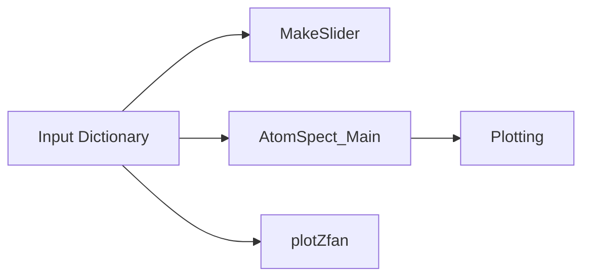

# What is AtomSpect?
AtomSpect is a newly developed Python package designed for simplify the spectroscopic analysis for diagnostic purposes. It has been developed to be lightweight and easy to implement into any diagnostic pipepline - aided by being fully open source with GPL-3.0 licensing.

AtomSpect is NOT intended to be a replacement for the robust ab-initio atomic structure calculations for energy levels. 

Please see the corresponding publication for further details of the physics and math: https://doi.org/10.1016/j.jqsrt.2026.110015

# Installation
To use: Unzip the repository and open one of the example scripts in the examples folder. Run the example script, not AtomSpect.py.


# Using AtomSpect
AtomSpect uses an Input Dictionary with several keyword arguments for the calculation. This includes a vast amount of optional keywords that can be passed. A full list and description of the keywords is provided below and in the function description for AtomSpect_Main.

The InputDict can be passed to either: MakeSlider, plotZfan, or AtomSpect_Main. MakeSlider and plotZfan will directly generate plots from the input file.



AtomSpect_Main outputs a dictionary with many results and intermediary steps. This output is passed into the PlotFunction to generate the plot. There are additional optional plot flags as well.

For HFS calculations, `rad` and the polarization stick partitions follow
eigenstate pairs, with q = mF_upper - mF_lower. The sigma stick keys retain
their emitted-light sign convention. Equal-energy eigenvectors can be
replaced by a definite-mF basis; only the summed intensity of coincident
lines has a basis-independent meaning. The returned `bigstatelist` remains
a list of basis-state pairs, rather than eigenstate labels.

PlotFunction requires a PlotObject and plot_vars. The PlotObject can be either the AtomSpect_Main output or a list of [wavelength,intensity].
The PlotFunction is robust with a lot of optional arguments. It is an array of plot axes which can be addressed via index. This gives the flexability of a generalized 2D plot array. You can feed this axis, which is the output of PlotFunction into PlotFunction.

In addition to the PlotObject, several plotting parameters are set with the plot_vars = [color, linewidth,linestyle, legendlabel, markerstyle(optional)]

Image showing a very simple example of operation. Additional spectra can be added but ensure to set makefig=False and axisin=thisaxs (per the Argon example shown here).
```python
InputdeckAr1 = {'s_ground': 0 ,  #Spin quantum number S of ground state (2S+1 is the multiplicity), int or half int
                's_excited': 0 , #Spin quantum number S of excited state (2S+1 is the multiplicity), int or half int
                'l_ground': 1 ,  #Orbital Angular Momentum of ground state, int or half int
                'l_excited': 0 , #Orbital Angular Momentum of excited state, int or half int
                'E_ground': np.array([95399.8276]) ,   #Lowest J first, in cm^-1
                'E_excited': np.array([108722.6194]) , #Lowest J first, in cm^-1
                'Bmag': 2.018 ,   #Magnetic Field [T]
                'b_angle': 90 ,   #Angle between LoS and Bmax
                'plottitle': 'Ar I 3p5 4s (1P) -> 3p5 4p (1S)' , #Title for plotting (optional)
                'spec_window' : [745,755], #Min and max convolutions
                'plot_window': [750.25,750.5], #Min and max for plot window range (nm)
                'amu': 40  , #Weight in AMU
                'specstep': 0.004 , #Pixel resolution of spectrometer in nm
                'SpectrumData': [shiftedAr, Ar_Spec['signals'][0]] ,
                }

Ar1 = AtomSpect_Main(InputdeckAr1)

plotvars = ['royalblue', 1.5, 'solid', 'Exact']
thisaxs = PlotFunction(Ar1, plotvars, NormalizeSig=True, makefig=True, plotlabel='B=2.018T')
```

The versatility of the plotting function is showcased across several of the included examples.

## Slider GUI!
An input dictionary can be fed into MakeSlider. Boolean flags exist for:
do_sticks - Plotting component "stick" lines. Default True
do_Polplot - Labels the polarization of each component stick. Default True
do_other - whether other_sticks are plotted (purple star sticks). Default False. This legacy option does not imply non-dipole emission.
banglevary - Whether angle of magnetic field is allowed to vary
polvary - Whether a polarization filter is along the line of sight and if the filter angle can vary.
Tmax - Maximum temperature [eV]. Default 30
Bmax - Maxium field strength [T]. Default 5

For the non-hyperfine axial Zeeman calculation, polarization labels follow the energy eigenstate pairs, using Delta M = M_upper - M_lower. Active E1 components have Delta M = 0 or +/-1. Earlier versions attached labels using basis-pair order, which could place allowed He I components in other_sticks. The emitted-light convention in the existing sigmaplus_sticks and sigmaminus_sticks keys is retained. Hyperfine polarization labeling requires a separate correction.

The Slider always lets: Bfield strength (in T), Temperature (eV), and Wi (~Spectrometer pixel resolution in nm) vary.
If you double click on the numerical value under the slider, you can enter a value directly to be calculated. The value entered here CAN be outside the normal slider ranges!

Each change in the slider currently (April 2026) causes a full recalculation, diagonalization, convolution, and re-plotting of the spectra.
Fortunately, this is optimized enough to be real-time viable.

Default ranges:
B: [0,5] T, dB: 0.01
T: [0.01,30] , dT: 0.01
Wi: [0.002,0.1] , dWi: 0.001
Bangle: , dBangle: 0.5
PolAngle: , dPolAngle: 0.5

Max Value 


## Input Dictionary Keys

                     's_ground': 3  , #Spin quantum number S (not the multiplicity 2S+1) of the ground state, e.g. 1 for a triplet; int or half int
                     's_excited': 3 , #Spin quantum number S (not the multiplicity 2S+1) of the excited state, e.g. 1 for a triplet; int or half int
                     'l_ground': 0  , #Orbital Angular Momentum of ground state, int or half int
                     'l_excited': 1 , #Orbital Angular Momentum of excited state, int or half int
                     'E_ground': np.array([2951.29 ]) , #np.array of lower state, Lowest J first, cm^-1
                     'E_excited': np.array([26229.77,27488.11,27889.68]) ,  #np.array of upper state, Lowest J first, cm^-1
                     'Bmag': .6 , #Magnetic Field  [T]
                     'b_angle': 60 , #Angle between LoS and Bmax
                     'Pol_angle': 0 , #Angle polarizing filter makes with max linear transmission
                     'amu' : 183 , #Weight in AMU
                     'Convfxn': 'Gaussian' , #Optional: 'Gaussian', 'GaussianInstrum'', 'Skewed' , 'Lorrentzian', 'Voigt'.
                     'Skewness' : [1.24,1.98] #Optional, [Left,Right] constant for the skewness of the lorrentzian function. Multiples of specstep, which is the FWHM of the lorrentzian (so 1 gives FWHM = specstep). If both are 1, it is a symmetric lorrentzian.
                     'Temp' : 300, #Temperature in K. Used for Gaussian, Gaussian Instrum, Voigt convolutions
                     'TempeV' : 20 , #Temperature in eV. Can be passed instead of Temp in K. Converted as needed internally.
                     'specstep' : 0.002222 , #stepsize of linefunction [nm]
                     'specres' : 10 , #How many points are evaluated per spectrometer pixel window. Higher means smoother curve.
                     'fxnwindow': 0.5 , #How far from the central peak the convolution will be calculated. Also related to how stick binning works. 
                     'plottitle': 'Excample Title' , #Title for plotting (optional).                      
                     'SpectrumData' : [[Wavelength],[Intensity]] , #List of arrays for wavelength (nm) and intensity (arb)
                     'spec_window' : [425,435], #Min and max for convolution window (nm)
                     'plot_window' : [425,435], #Min and max for plot window range (nm)
                     'HFS_G' : [505.5e6] , #Optional: Hyperfine A constant for the lower level, need one entry per J level, lowest J first [Hz]
                     'HFS_E': [0, 496.2e6, 440.5e6] , #Optional: Hyperfine A constants for upper level, need one entery per J level, lowest J first [Hz]
                     'I_spin' : 0.5, #Optional: nuclear spin, I. Tabulated by Stone et al.
                     'mu_I' :  .11778476 , #Optional: Nuclear dipole moment as tabulated by Stone.              
                     'HFSB_G' : [505.5e6] , #OPtional: Hyperfine B constant for the lower level, need one entry per J level, lowest J first [Hz]
                     'HFSB_E': [0, 496.2e6, 440.5e6] , #Optional: Hyperfine B constants for upper level, need one entery per J level, lowest J first [Hz]
                     'Calc_HFS_Vals': [False,False], #Optional. Passed regarding wether HFS constants A and B should be approximated for values of 0 above. NOT YET IMPLEMENTED
                     'ion_vel' : Float or [Float1,Float2] , #Velocity of particles, mono and bidirectional allowed. A single value can be passed and used for bidirectional splitting if bidir flag is set.
                     'bidir' : True , #Bool as to whether ion motion generates bidirection doppler shift
                     'PsiHFS' : True , #Bool, testing flag left in for completeness
                     'DoLowSig' : True , #Bool for whether Lowfield approximation and signal are included and plotted
                     'DoHighSig' : True , #REQUIRES TERM ENERGY!Bool for whether Highfield approximation and signal are included and plotted
                     'EtermG': 169086.9076, #Term energy of lower state in cm^-1 - Required for DoHighSig
                     'EtermE' : 191444.47832914, #Term energy of upper state in cm^-1 - Required for DoHighSig
                     'sortE' : True , #Bool as to whether the wavefunctions will attempt to be sorted based on expected resulting energy before diagonalization. This significantly slows down operations. 
                      }
                      


For non-HFS high-field spectra, provide both `EtermG` and `EtermE` in cm^-1; zero is a valid term energy. This electronic Paschen-Back approximation neglects fine-structure splitting and uses the existing ideal factors g_L=1 and g_S=2. Eigenvectors are returned in the coupled basis used by the transition-strength calculation. Missing term energies raise a clear error.

# Plotting Zfans

`DoLowSig` and `DoHighSig` enable approximation spectra when True and skip
them when False or omitted. Legacy yes/no strings are also accepted,
case-insensitively (`Y`/`Yes`/`True` and `N`/`No`/`False`), as are 1 and 0.
Disabled approximations add no output keys and need no term-energy inputs.
HFS approximation spectra are not implemented: enabling these flags with
`I_spin` raises `NotImplementedError`. These spectrum flags are separate
from the `L`/`H` flags used by the fan functions.

AtomSpect can do typical Zeeman Fan plots with a dedicated set of functions which has been optimized for significant speed.
Compared to a normal InputDictionary, 'Bmag' needs to be an array of magnetic field values. The flags refer to:
"G" - Ground
"E" - Excited
"H" - Add High-field approximation. Without HFS, this requires Term Energy.
"L" - Add Low-field approximation (no diagonalization)

At least "G" or "E" are required, otherwise, any combination of the flags, in any order, may be passed into plotZfan.

For HFS, "H" uses the hyperfine Paschen–Back approximation in the
`|J,mJ;I,mI>` basis, with the A/B constants in Hz and energies in cm^-1.
It includes the diagonal dipole and quadrupole shifts and the nuclear
Zeeman contribution. It uses each J level's supplied fine-structure energy;
`EtermG`/`EtermE` are not needed. This approximation applies when the Zeeman
interaction dominates hyperfine splitting while remaining small relative
to fine-structure splitting. It does not describe the electronic
Paschen–Back regime where J levels mix. See
[Steck's Rb85 data, Eq. (25)](https://steck.us/alkalidata/rubidium85numbers.pdf).

```python
Bfan = np.linspace(0, 1, 5000)
InputdeckRbHFS_fan = {'s_ground': .5 ,  #Spin quantum number S of ground state (2S+1 is the multiplicity), int or half int
                      's_excited': .5 , #Spin quantum number S of excited state (2S+1 is the multiplicity), int or half int
                      'l_ground': 0 ,   #Orbital Angular Momentum of ground state, int or half int
                      'l_excited': 1 ,  #Orbital Angular Momentum of excited state, int or half int
                      'E_ground': np.array([0]) ,  #Lowest J first, in cm^-1
                      'E_excited': np.array([12578.95, 12816.545]) ,  #Lowest J first, in cm^-1
                      'Bmag': Bfan,    #Magnetic Field  [T]
                      'b_angle': 90 ,  #Angle between LoS and Bmax
                      'plottitle': 'Rb85, I = 5/2, S = 1/2, L = 1' , #Title for plotting (optional)
                      'plot_window' : [775,799] , #Min and max for plot window range (nm)
                      'amu' : 85 ,  #Weight in AMU
                      'Temp' : 300,
                      'HFS_G' : [1011e6] ,  #Optional: Hyperfine A constant for the lower level, need one entry per J level
                      'HFS_E': [120.527e6, 25.0354e6], #Optional: Hyperfine A constants for upper level, need one entry per J level
                      'HFSB_E': [0, 25.898e6] ,
                      'I_spin' : 5/2, #Optional: nuclear spin, I, including parity. Tabulated by Stone et al.
                      'mu_I' :  1.35298, #Optional: Nuclear dipole moment as tabulated by Stone.
                      }

# InputRb['Bmag'] = Bfan
RBFanG = plotZfan(InputdeckRbHFS_fan, flags='G', markercount=0)
plt.xlim(0, .5)
plt.ylim(-.4, .4)
plt.tight_layout()
plt.show()
```


# Future Developement
Stark Shift. Work is already well underway for implementing the DC stark shift for electric fields into the package.
Hyperfine Constants. Preliminary work is done and results are sound, just need to simplify and streamline the calculation into AtomSpect_Main
Importing/saving data. We plan to allow for importing of atomic energy level data such as from then Open ADAS work. This also includes building up a database of atoms and energies for quick use such that the user doesn't need to type in the details for every line they are interested. This goes great with the next feature...
Fancy GUI! The Slider GUI is okay, but is unable to handle multiple species/lines. A robust GUI is in the initial stages of design which would transform everything about using AtomSpect.

# Data Use
The spectromter data provided in the He and Ar spectra was collected by Tommy Gonda, Matt Kriete, and David Ennis. This data is used and included here with their permission. 

The CIII data is from the Aurora public data set: http://dx.doi.org/10.35099/aurora-70

All data provided here is open source and free to use. Additional spectrometer data is always welcome.


I kindly request that any works that utilize this code reference the AtomSpect publication:(https://doi.org/10.1016/j.jqsrt.2026.110015)

Contact me at: lmn0022@auburn.edu

